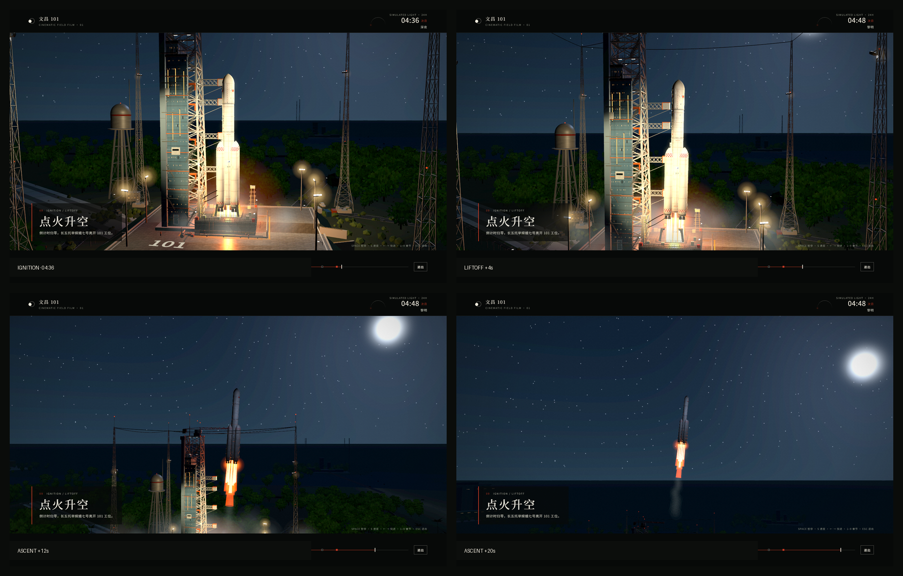
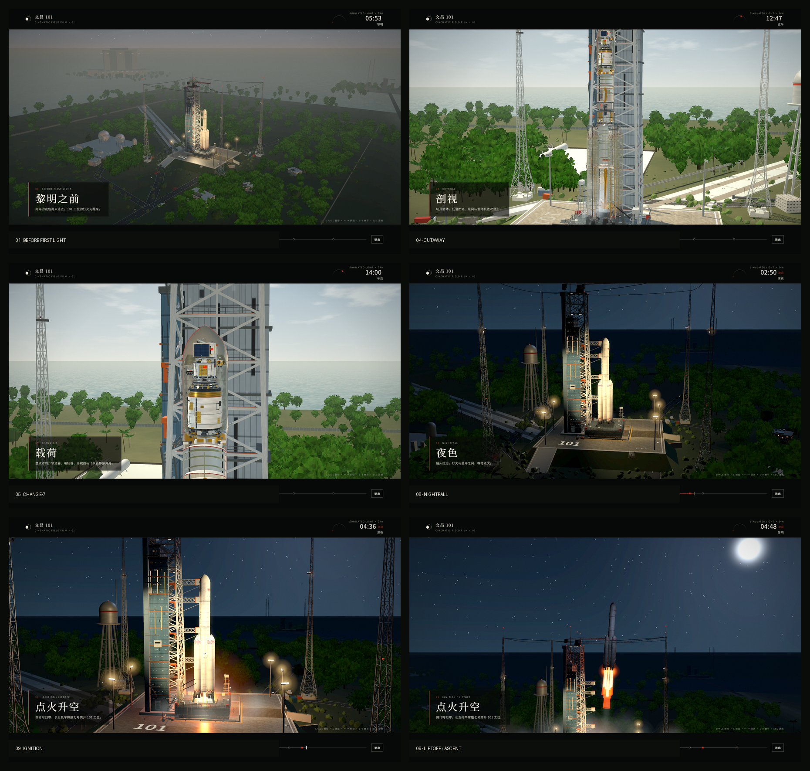

# 文昌 101 · 长征五号 / 嫦娥七号

**单文件离线 3D 交互场景 · Three.js r160 · 影视级电影运镜 · 点火升空**

海南文昌航天发射场 101 工位，发射台上的长征五号（CZ-5）与嫦娥七号探测器。
包含可半剖的箭体内部、可分解的级间/载荷视图、纸质航天档案风格 UI、完整
24 小时昼夜光轨，以及一部 118 秒电影：从黎明远眺、环绕、剖视、载荷特写、
分解、暮色、夜色，到最后的点火升空与箭体追随。

[**直接打开 `index.html` →**](index.html)



## 作品亮点

- **单文件、离线**：Three.js、几何、纹理、标注、UI 全部内联；`file://` 双击即开，无任何外部请求。
- **真实材质与影视光影**：PBR 材质、MSAA 4×、ACES tone mapping、泛光、色彩分级、暗角、胶片颗粒。
- **可剖视**：真实裁切平面与切面截面带，展示液氢/液氧贮箱、共底、环框/桁条、输送管、
  YF-77/YF-75D 发动机、级间桁架与上面级内部。
- **可分解**：一级、二级、助推器、整流罩与载荷分层展开，动画可逆。
- **嫦娥七号**：轨道器、着陆器、六轮巡视器、飞跃器与 YZ-2 上面级；整流罩内构与分离导轨。
- **纸质档案 UI**：米白纸张、墨黑、朱砂红；Serif 标题与编号系统；带避让的 3D 标注。
- **118 秒电影运镜**：9 个章节；24 小时太阳轨迹与场区灯光连续变化；章节点击、进度拖动、
  暂停、退出、重播、返回探索。
- **播放速度**：`1× / 1.5× / 2× / 3×`，播放中随时切换，不改变影片时间码。
- **结尾点火升空**：尾焰、烟云、上升烟迹、追踪补光、追随升降镜头与轻微震动；发射结束后
  可「重播」或「返回探索」，火箭自动复位。
- **桌面与手机自适应**：移动端自动降低像素比、MSAA 与阴影成本。



## 操作

| 操作 | 说明 |
| --- | --- |
| 拖动 / 单指拖动 | 环绕观察 |
| 滚轮 / 双指捏合 | 推拉镜头 |
| 双击画布 | 回到全景 |
| 底栏 `整体 / 剖视 / 分解` | 整箭、半剖面、级间分解 |
| 剖切深度滑杆 | 在剖视模式下控制剖切量 |
| 底部 `全景 / 塔架 / 剖面 / 载荷 / 动力` | 五个镜头预设 |
| 左侧结构索引 / 3D 标注 | 部件档案与飞近定位 |
| 右上 `日间 / 夜间` | 两种光照氛围 |
| 右上 `电影` | 播放 118 秒电影 |
| `P` | 启动电影 |
| `1–5` | 切换镜头预设 |
| `C` / `X` | 剖视 / 分解 |
| `N` / `L` / `F` | 夜间 / 标注 / 全屏 |
| `Space` / `S` / `← →` | 电影中暂停 / 切换速度 / 快进 |
| `Esc` | 退出电影或关闭卡片 |

电影直达参数：`?tour=1` 自动播放；`?tourat=46` 停在某秒；`?speed=2` 指定初始速度。
速度也可在电影底栏或按 `S` 切换。

## 运行 / 重建

无需安装、无需服务器：

1. 下载 [`index.html`](index.html)；
2. 双击用浏览器打开。

如希望重新构建：

```bash
node build-wenchang.js --out=index.html
```

源码在 [`src-wenchang/`](src-wenchang/)，构建脚本为 [`build-wenchang.js`](build-wenchang.js)，
Three.js r160 位于 [`vendor/three.classic.js`](vendor/three.classic.js)。仓库已包含构建产物，
普通浏览者无需执行构建。

## 生成提示词

完整提示词与一段话版本：[**PROMPTS.md**](PROMPTS.md)

- 详细提示词：场景、模型、UI、剖视/分解、24 小时光照、118 秒运镜、点火升空、技术约束与验收标准。
- 简约一段话提示词：可直接用于快速复现。

## 数据与致谢

- 火箭内部、嫦娥七号构型、发射场细节与发射时序为 **科普示意**，依据公开资料与影像资料
  重建，不是工程图纸，也不代表任何真实任务状态。CZ-5 公开参数：全长 56.97 m、
  芯级 ⌀5 m、起飞质量 851.8 t、起飞推力约 1,078 tf、地月转移轨道运力 8.8–9.4 t。
- 使用 [Three.js](https://threejs.org/) r160（MIT License）。全部几何、纹理、标识与 UI
  由本项目代码生成；无第三方图片、字体文件或 CDN 资源。
- 设计目标为“3A 游戏场景 / 红点与 IF 设计奖级视觉”，不表示获得任何奖项或官方背书。

## English

An offline, single-file Three.js experience of Wenchang LC-101 with a CZ-5 / Chang'e-7
stack: real-time PBR materials, a true cutaway interior, exploded stage/payload views,
a paper-and-ink dossier UI, a 118-second cinematic spanning a full simulated day and
night, adjustable playback speed, and a closing ignition/liftoff sequence. Open
`index.html` directly; no build server or network access required.
